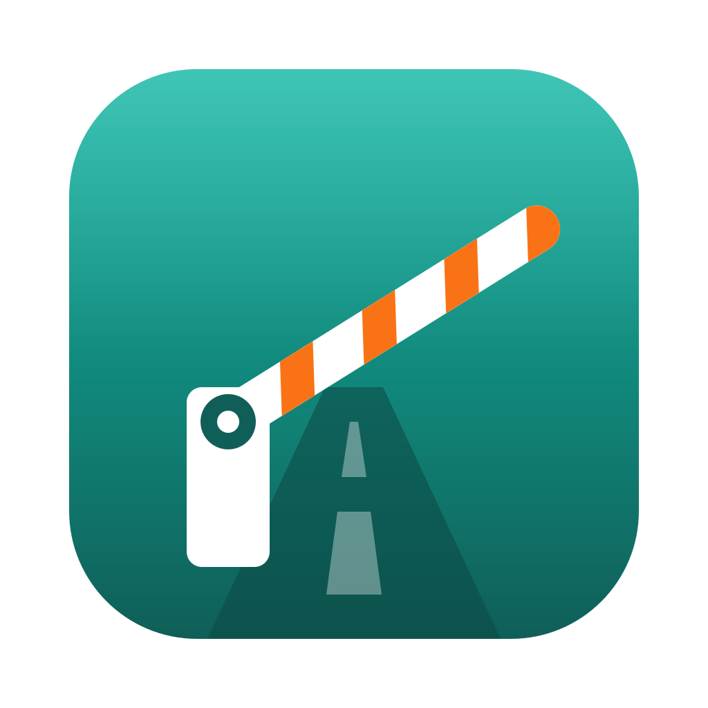

# CLI Tollgate

A macOS menu bar app and Windows tray app that turns **one ChatGPT subscription and one Claude
subscription** into a local OpenAI-, Anthropic- and Codex-compatible API on `http://127.0.0.1:8317`.

It bundles [CLIProxyAPI](https://github.com/router-for-me/CLIProxyAPI) (built from your fork, linked as the
`engine/` git submodule) and runs it as a helper process. Nothing is hosted: the proxy, your OAuth tokens
and your config never leave your computer.

> Using subscription logins through a proxy is not an officially supported route by OpenAI or
> Anthropic and can break or be restricted without notice.

## Features

- **Sign in from the menu bar**: one ChatGPT (Codex OAuth) account and one Claude account. Signing in
  again replaces that provider's account. Shows the email, plan and rate-limit cooldowns.
- **Model exposure**: show or hide each model per provider, and give any model an extra alias
  (for example `sonnet` → `claude-sonnet-4-5-…`). The original ID keeps working.
- **Cloaking, on by default, chosen per model**: one switch in the menu. The disguise follows the
  requested model, whatever the client is:
  - Claude models → disguised as **Claude Code** (real Claude Code requests pass through unchanged).
  - GPT / Codex models → sent with the official **Codex CLI** identity headers.

  Settings → Advanced lets you turn each side off separately, and choose whether Claude model IDs
  are cloaked in `/v1/models`.
- **Web pages can call it**: binds to loopback only and CORS is open, so browser apps can use it.
  Every request still needs the API key.
- **Copy setup** for Claude Code, Codex CLI, OpenAI-compatible SDKs, `fetch()` and `curl`.
- **Today's usage** (requests and tokens) in the menu, from the engine's usage tracker.
- **Launch at login**, port setting, API-key rotation, logs, crash auto-restart.
- **Auto-update** via [Sparkle](https://sparkle-project.org). The feed is the `appcast.xml` attached to
  the latest GitHub release, so no website is needed.

## Letting a web app use your subscriptions

A web app doesn't need the user to copy and paste a key. It can ask for one:

1. The page generates a random key (32+ characters of `A-Z a-z 0-9 - _ .`) and sends
   `POST http://127.0.0.1:8317/access/requests` with `{"name": "My App", "key": "<key>"}`.
   The response is `202 {"id": "…", "status": "pending"}`.
2. CLI Tollgate shows **Allow “My App” to use your subscriptions?** with the page's origin.
   Deny is the default button.
3. The page polls `GET /access/requests/<id>?wait=50` (each call waits up to 55 s) until the status is
   `approved`, `denied` or `expired`. Once it's approved, the page uses its key as a normal API key.

Allowed apps are listed under **Settings → Connected apps**, where you can revoke them. Revoking an app
turns its key off right away. Regenerating your own API key doesn't affect connected apps.
A ready-to-copy `requestTollgateAccess()` helper and a demo page are in
[`examples/web-app/index.html`](examples/web-app/index.html).

Safeguards: requests are only accepted from this computer, and only while the app is running to answer
them. There is one pending request per origin, and an origin has to wait 30 s after a denial before it
can ask again. Requests expire after 5 minutes. The key never comes back from the server, and
`access-grants.json` keeps only key hashes.

## Install

1. Download `CLI-Tollgate-<version>.dmg` from [Releases](../../releases) and drag the app to Applications.
2. The app is ad-hoc signed (no Apple Developer ID), so the first launch is blocked by Gatekeeper.
   Either open **System Settings → Privacy & Security → Open Anyway**, or run:
   ```sh
   xattr -dr com.apple.quarantine "/Applications/CLI Tollgate.app"
   ```
   Later updates install through Sparkle and are verified with an Ed25519 signature, so you only
   need to do this once.

Data lives in `~/Library/Application Support/CLI Tollgate/` (`config.yaml`, `auths/`, `logs/`).

## Windows

The Windows variant (in [`windows/`](windows)) has the same features: tray icon, both sign-ins, model
exposure and aliases, cloaking, copy-ready setup (PowerShell syntax), today's usage, port and API-key
settings, launch at sign-in, crash auto-restart and signed auto-updates.

1. Download `CLI-Tollgate-Setup-<version>.exe` from [Releases](../../releases) and run it. It installs
   per user into `%LOCALAPPDATA%\Programs\CLI Tollgate`, so no administrator rights are needed.
   A portable `CLI-Tollgate-<version>-windows-x64.zip` is published too. Auto-update only works for the installed version.
2. The installer isn't code-signed, so SmartScreen may warn on first run: choose **More info → Run anyway**.
   Updates are downloaded by the app and installed only if their Ed25519 signature matches. It uses the
   same key as Sparkle on macOS.

Left-click the tray icon to open the window (Overview, Models, Settings). Right-click it for quick actions:
copy the base URL, API key or a setup snippet, sign in, toggle cloaking, start/stop, logs and updates.
The icon turns grey while the proxy is stopped, and shows an amber dot when no account is signed in and
a red dot when the engine failed.

Data lives in `%LOCALAPPDATA%\CLI Tollgate\` (`config.yaml`, `auths\`, `logs\`), and uninstalling keeps it.

How it differs from the Mac app under the hood:

- Go instead of Swift. The window is WebView2 (part of Windows 10/11) showing an embedded HTML UI, served
  on a random loopback port. The UI unlocks with a per-launch token exchanged for a `SameSite=Strict`
  cookie, and requests must also carry a custom header and the server's own `Host`. If WebView2 is missing,
  the UI opens in the default browser instead.
- The engine runs in a Windows job object, so it can never outlive the app, even after a crash.
- Updates: the release has a `latest-windows.json` feed. The app checks it daily, downloads newer installers,
  verifies them, and installs on quit (or right away with **Restart to update**).

## How it works

```
 Menu bar app (SwiftUI) ──MANAGEMENT_PASSWORD (per launch)──▶ tollgate-engine (CLIProxyAPI)
        │                                                        │ 127.0.0.1:8317
        └── /v8/management: OAuth, credentials, config ──────────┘
 Clients / web pages ──Bearer <api key>──▶ /v1/chat/completions, /v1/messages, /v1/responses …
```

- On first launch the app writes a minimal `config.yaml` (loopback host, random API key, usage tracker
  on). After that the engine owns the file and every change goes through its management API, which
  hot-reloads it.
- The management API is unlocked with a random password generated on every launch and passed only
  through the helper's environment. No management key is stored on disk.

## Development

Requirements: macOS 13+, Xcode 16+, Go (version from `engine/go.mod`), [XcodeGen](https://github.com/yonaskolb/XcodeGen).

```sh
git submodule update --init  # engine/ = the CLIProxyAPI fork
scripts/build-engine.sh      # universal tollgate-engine into build/engine/
xcodegen generate            # creates CLITollgate.xcodeproj
open CLITollgate.xcodeproj   # run the CLITollgate scheme
```

`scripts/build-engine.sh` builds the fork's **committed** HEAD, unmodified, from `$ENGINE_SRC`, else
`engine/`, else `~/workspace/CLIProxyAPI`.

### Windows app

Only Go is needed. It cross-compiles from Linux or macOS, with no CGO:

```sh
VERSION=0.1.0 BUILD=1 scripts/build-windows.sh   # engine + "CLI Tollgate.exe" into build/windows/
(cd windows && go vet ./... && go test ./...)
```

To work on the UI without Windows, run the same app in dev mode (no tray) against a Linux engine and open
the printed URL in a browser:

```sh
scripts/build-engine.sh linux
cd windows && TOLLGATE_DATA_DIR=/tmp/tollgate TOLLGATE_ENGINE=../build/engine/linux/tollgate-engine \
  go run . --ui-addr 127.0.0.1:8399
```

The installer is built in CI with Inno Setup from
[`windows/installer/CLITollgate.iss`](windows/installer/CLITollgate.iss).

### Updating the engine

Commit in your fork, push it, then bump the submodule:

```sh
git -C engine pull && git add engine && git commit -m "Bump engine"
```

## Releasing

1. One-time: add the repository secret `SPARKLE_PRIVATE_KEY` containing the PEM Ed25519 private key
   whose public half is `SUPublicEDKey` in [`project.yml`](project.yml).
2. Bump `MARKETING_VERSION` in `project.yml` if you like (CI overrides it from the tag), then:
   ```sh
   git tag v0.1.0 && git push origin v0.1.0
   ```
3. GitHub Actions builds both apps. macOS gets a `.zip` and `.dmg`. Windows gets the installer and a
   portable zip, after smoke-testing the engine, single-instance, job object and silent install/uninstall
   on a Windows runner. Then it signs the macOS zip and the Windows installer, writes `appcast.xml` and
   `latest-windows.json`, and publishes one release. Installed copies pick it up within a day, or
   immediately via **Check for Updates…**.

The repository must be **public** so both updaters can download the feeds and files without credentials.

## License

The bundled engine is CLIProxyAPI, MIT licensed (see `engine/LICENSE`). Choose a license for the app code before publishing.
